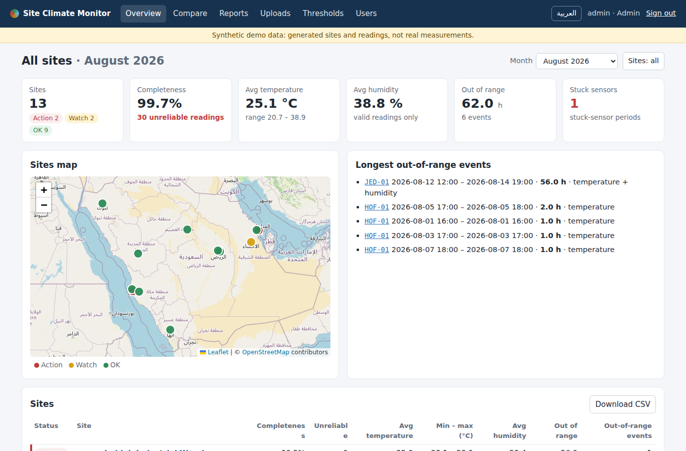
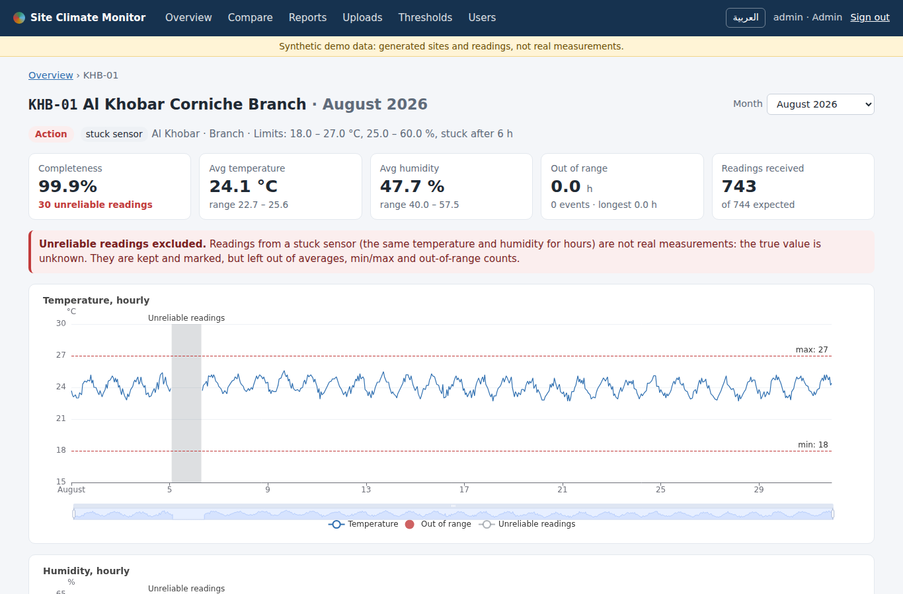
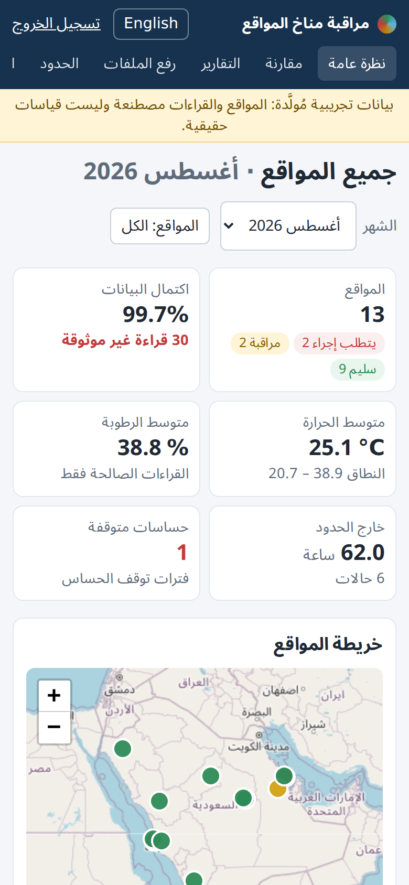
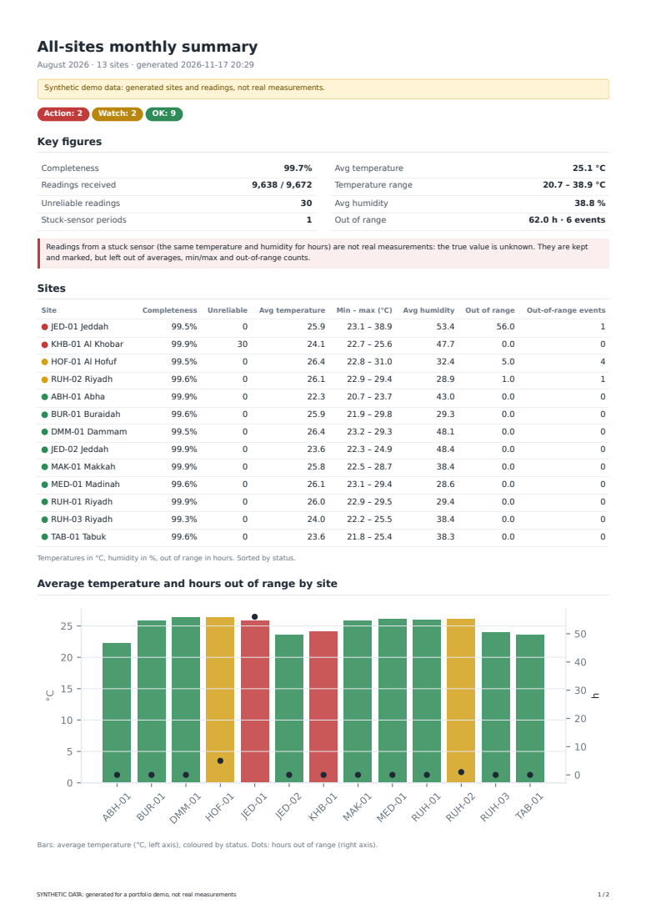
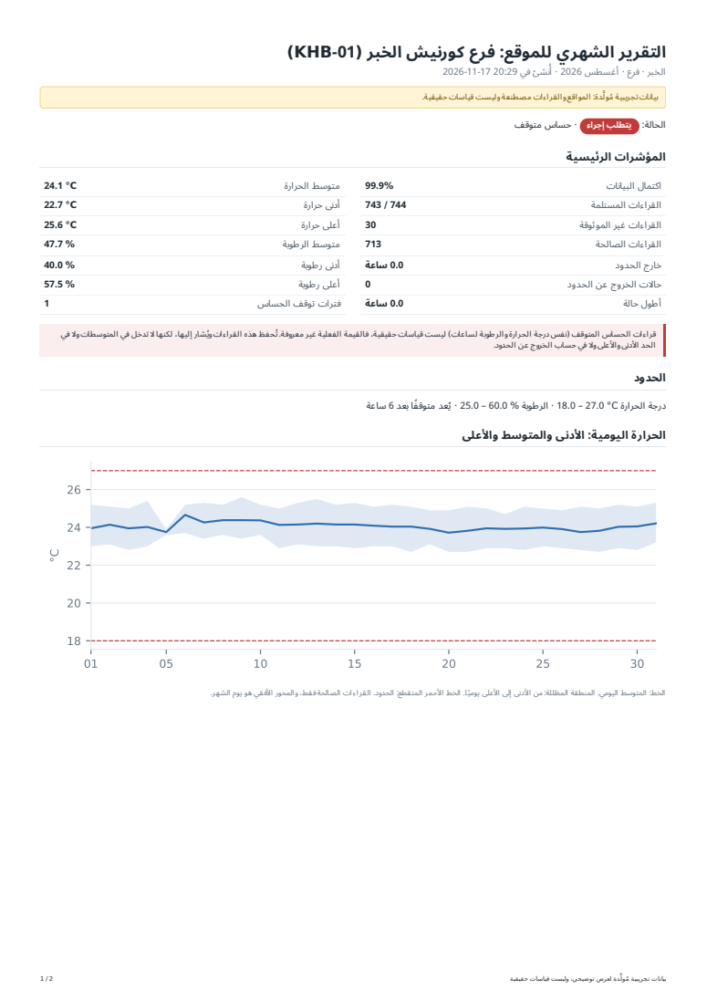
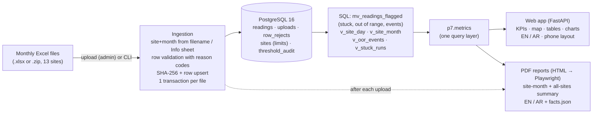

# P7 — Multi-Site Sensor Monitoring Dashboard

[](https://github.com/zeyadosmoh/multi-site-sensor-dashboard/actions/workflows/ci.yml)

> **⚠️ Synthetic data.** Every site, reading and user in this repository comes from a seeded generator (`python -m p7 generate`, seed 7). The site names are invented. City coordinates are real so the map looks right. No real company or sensor data is used. The app banner, every CSV and every PDF carry the same notice.

A portfolio project for a freelance service. It takes the monthly Excel files of temperature and humidity readings from 13 warehouses and branches and does four things:
1. **validates every row** and keeps a validated history in PostgreSQL;
2. computes the **metrics in SQL**;
3. shows them on a **web dashboard for management**, in English and Arabic, on desktop and phone;
4. produces **PDF reports** with the same numbers.

| Overview (desktop) | Site page: a stuck sensor's readings excluded | Phone, Arabic |
|---|---|---|
|  |  |  |

| Monthly summary PDF (EN) | Site report PDF (AR) |
|---|---|
|  |  |

Sample PDFs (August 2026):
- summary: [EN](docs/sample-reports/2026-08/all-sites_2026-08_en.pdf) · [AR](docs/sample-reports/2026-08/all-sites_2026-08_ar.pdf)
- KHB-01, stuck sensor: [EN](docs/sample-reports/2026-08/KHB-01_2026-08_en.pdf) · [AR](docs/sample-reports/2026-08/KHB-01_2026-08_ar.pdf)
- JED-01, cooling failure: [EN](docs/sample-reports/2026-08/JED-01_2026-08_en.pdf) · [AR](docs/sample-reports/2026-08/JED-01_2026-08_ar.pdf)

Each PDF has a `facts.json` next to it with every number it prints.

## What this proves

- **Messy files in, exact results out.** The generator writes 78 Excel files (13 sites × May–Oct 2026, hourly) with planted problems:

  | Problem | Example |
  |---|---|
  | Missing hours | scattered gaps, plus a 48-hour outage |
  | Duplicates | 5 exact, 3 conflicting |
  | Impossible values | 85 °C, −60 °C, 120 %, blank, `ERR` |
  | Stuck sensor | 30 hours |
  | Layout | an extra title row |
  | Dates | `DD/MM/YYYY` text and Excel serial numbers |
  | Identification | a file named `sensor_export_final (2).xlsx`, identified only by its cover sheet |
  | Real out-of-range events | a 56-hour cooling failure, a 3-day heat wave, a 9-hour water leak |

  Every problem is recorded in a `manifest.json`. Ingestion matches it exactly:
  - **78 / 78** files;
  - **57,109 / 57,109** readings;
  - **21** rejected rows with the right reason per file;
  - the stuck run found to the hour;
  - each planted event detected.

  `python -m p7 verify-manifest` checks this, and so does CI.
- **Idempotent and safe to retry.**
  - **Same file again:** reloading all 78 files plus the sample zip gives 91 `duplicate_file` results and **0 changed rows**.
  - **Corrected file:** only the hours that differ are inserted or updated, and the log reports *new / changed / unchanged*.
  - **One transaction per file:** a test crashes one file part-way through; it leaves **no partial rows**, the other files in the batch still load, and the failure stays in the upload log.
- **Stuck sensors can't make a site look safe.** A sensor repeating 23.4 °C / 41.0 % for 30 hours is flagged as **30 unreliable readings**. They are kept and marked, but excluded from averages, min/max and out-of-range counts, and shown next to completeness: KHB-01, August, "99.9 %, 30 unreliable". The site is marked *Action*. Hand-checked tests cover:
  - the exclusion itself;
  - a stuck block in the middle of an out-of-range period, which splits it into two events;
  - a site where every reading is stuck, which has no averages at all.
- **PDF numbers = dashboard numbers = an independent recomputation.** The PDFs and the dashboard read the same metric queries and the same formatting code. Tests extract the text of English and Arabic PDFs and compare every key figure with a plain-Python recomputation from the raw `readings` table, which uses no SQL views. That covers all 13 rows of the monthly summary.
- **Metrics in SQL, checked by hand.** The views compute:
  - averages, min and max per day and month;
  - completeness %;
  - minutes and events out of range against per-site limits (editable and audited);
  - stuck-sensor runs, using gaps-and-islands window functions.

  Small fixtures with the expected values worked out by hand in comments cover:
  - inclusive limits;
  - a gap ending an event;
  - an event crossing midnight;
  - 5 vs 6 identical hours;
  - a 30-minute reading interval.
- **Two roles, enforced on the server, tested on every route.** A matrix test calls every route as anonymous, management and admin. Management gets 403 on every admin route (uploads, thresholds, users, report rebuilds), even with a valid CSRF token. Also tested:
  - CSRF on every state change;
  - open-redirect guards;
  - login throttling;
  - sessions ending when a password changes or a user is deactivated.

  The pages run under a strict CSP with no inline script or style.
- **Bilingual and usable on a phone.**
  - Arabic is one file, `ar.json`, with every English key; a test checks key parity and placeholders.
  - Numbers, ranges and ratios are isolated left-to-right runs, so "743 / 744" and "22.7 – 25.6" never flip in right-to-left text.
  - Arabic site and city names appear in the UI and the PDFs.
  - The screenshot script fails if any page scrolls sideways at 390 px or logs a console or CSP error.
- **Tested end to end.**
  - **132 pytest tests**, covering: validation cases, workbook/detection, ingestion and idempotency, hand-checked metrics, role permissions, web flows, i18n, and PDF numbers in English and Arabic.
  - **CI** runs: lint → generate (checks the committed sample zip is byte-identical) → load all 78 files → verify against the manifest → re-ingest (must change nothing) → tests → sample PDFs → Docker image build.

## Architecture



## Stack and ports

| Part | Choice | Why |
|---|---|---|
| Web | FastAPI + Jinja2 + HTMX + Apache ECharts 5.5.1 + Leaflet 1.9.4 (vendored, pinned) | Roles enforced and tested per route on the server. The same Jinja templating also makes the PDFs. Full control over right-to-left layout. |
| Map | Leaflet + OpenStreetMap tiles | No paid API key |
| Metrics | Plain SQL views plus one materialized view (no dbt) | The data is small and limit edits must apply immediately. dbt is shown in P3. |
| Database | PostgreSQL 16 | `127.0.0.1:5437` |
| App | uvicorn | `127.0.0.1:8790` |
| PDF | HTML → Playwright Chromium; matplotlib SVG charts; Noto Sans Arabic | Same approach as P3 |
| Excel | openpyxl (read-only) | Macro workbooks rejected; zips read in memory with size and ratio limits |

## Quick start

```bash
python3 -m venv .venv && .venv/bin/pip install -e '.[dev]'     # project-local only
.venv/bin/python -m p7 setup-env                                # .env with random secrets (never committed)
docker compose up -d postgres                                   # 127.0.0.1:5437
.venv/bin/python -m p7 generate --sample-month 2026-08          # 78 synthetic files + manifest.json
.venv/bin/python -m p7 migrate && .venv/bin/python -m p7 create-admin
.venv/bin/python -m p7 ingest data/synthetic/xlsx --no-reports  # ~7 s; PDFs are then built on demand
.venv/bin/python -m p7 verify-manifest                          # MATCH
.venv/bin/python -m p7 serve                                    # http://127.0.0.1:8790 (admin / ADMIN_PASSWORD in .env)
.venv/bin/python -m pytest                                      # 132 tests, separate p7_test database
```

To run everything in Docker (Postgres and the app, which includes Chromium): `docker compose --profile app up -d --build`. See [docs/deployment.md](docs/deployment.md).

## Docs

- [User guide](docs/user-guide.md), with screenshots for management and admin users
- [Deployment guide](docs/deployment.md): Docker, HTTPS proxy, backups, troubleshooting
- [Metric definitions](docs/metrics.md): completeness, unreliable readings, out-of-range events, status rules

## Project layout

```
src/p7/
  generate/      seeded synthetic sites, hourly series, Excel writer with planted problems + manifest
  ingest/        excel.py (header/cover sheet) · detect.py (site+month) · validate.py (reason codes) · pipeline.py
  db/sql/        001_schema.sql · 002_site_names_ar.sql · views.sql (metrics)
  metrics.py     the one read layer for dashboard + PDFs
  web/           FastAPI app, routes (views / admin), templates, static (app.js, app.css, vendored libs)
  reports/       facts.py (every printed number) · charts.py · build.py · templates
  i18n/          en.json · ar.json
scripts/         screenshots.py · pdf_preview.py · check_i18n_keys.py
tests/           validation, ingestion, manifest, metrics, web roles, i18n, PDF numbers
```

## Limitations

- **Readings are hourly by default.** Other intervals work through `app_config.reading_interval_minutes`, but the generator only makes hourly data.
- **Metrics use the site's current limits.** Each PDF prints the limits it used, and older PDFs are marked stale after a change.
- **Some upload messages stay in English.** Warnings and file-level error messages in the upload log are English in both languages. The row reject reasons are translated.
- **Map tiles come from openstreetmap.org.** That fits a small internal dashboard. See the deployment guide for heavier use.
