# User guide

> All sites, readings and users shown here are **synthetic** demo data.

The dashboard shows temperature and humidity from 13 sites, built from the monthly Excel files that sites send in. Every page works on a phone, in English or Arabic. Use the **العربية / English** button in the header to switch.

| Who | Can do |
|---|---|
| **Management** | View every page and download PDF reports and CSV files |
| **Admin** | Everything management can do, plus upload files, edit limits per site and manage users |

## Sign in

Open the address your admin gave you and sign in. After five wrong passwords in a row, wait a few minutes before trying again.

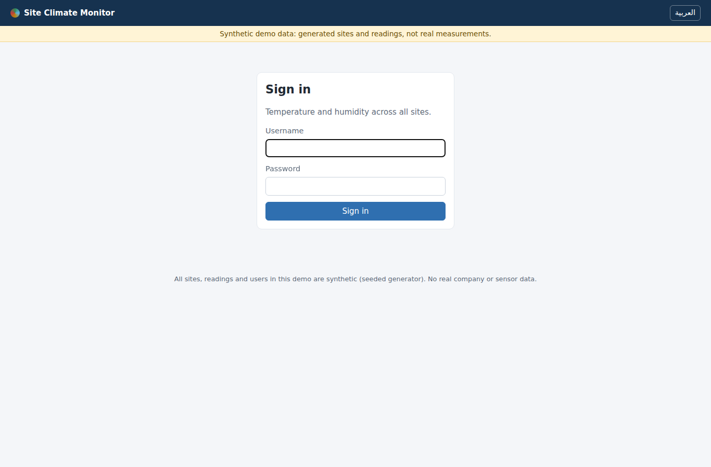

## Overview

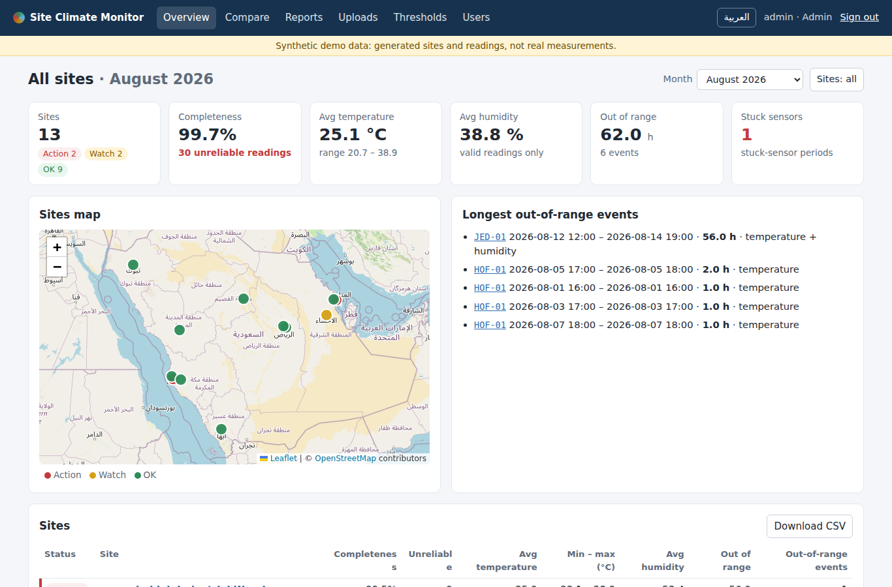

- **Filters.** Pick a month, or *All months*, and optionally a subset of sites. The address bar keeps your choice, so a link you share shows the same view.
- **Key figures.**

  | Figure | Meaning |
  |---|---|
  | Sites | How many sites have each status |
  | Completeness | Share of expected hourly readings that arrived. The number of **unreliable readings** is shown right under it. |
  | Average temperature and humidity | Valid readings only |
  | Out of range | Hours outside the limits, and the number of events |
  | Stuck sensors | Number of stuck-sensor periods |

- **Status colours.**

  | Colour | Name | When |
  |---|---|---|
  | 🔴 | **Action** | completeness under 80 %, out of range for more than 1 % of the time, or a stuck sensor |
  | 🟡 | **Watch** | completeness under 95 %, or any reading out of range |
  | 🟢 | **OK** | everything else |

- **Map.** Click a site to see its numbers and a link to its page.
- **Sites table.** The worst sites are listed first. The reason for each status is written under the site's name. **Download CSV** exports the table exactly as filtered.

On a phone the table becomes one card per site:

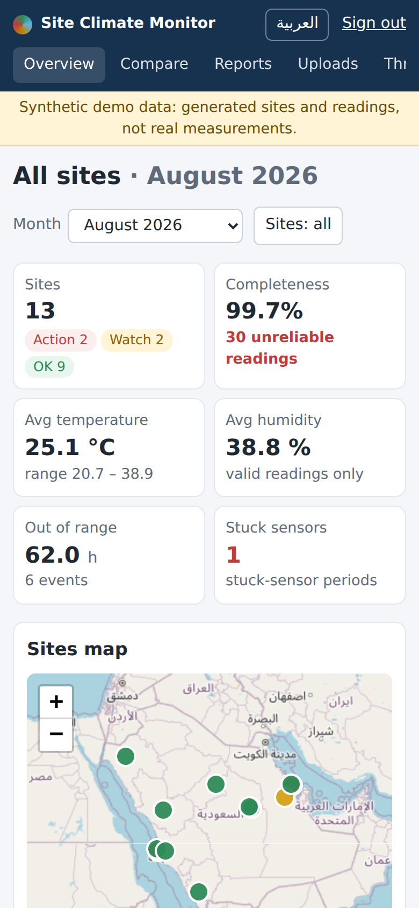 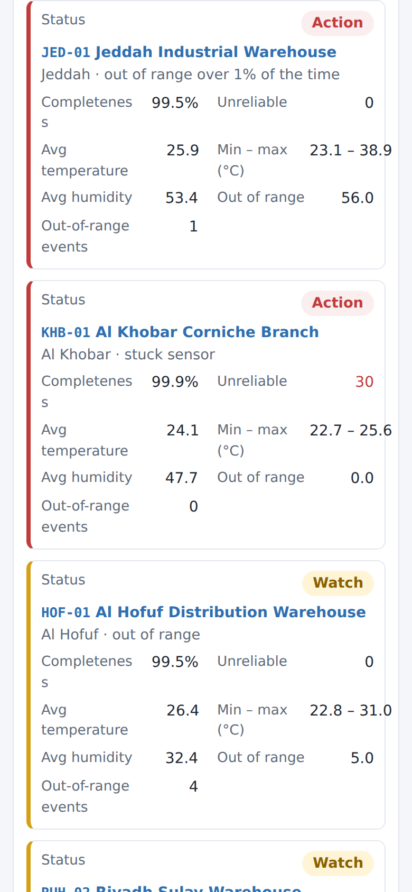

## Site page

Click a site name to open its page.

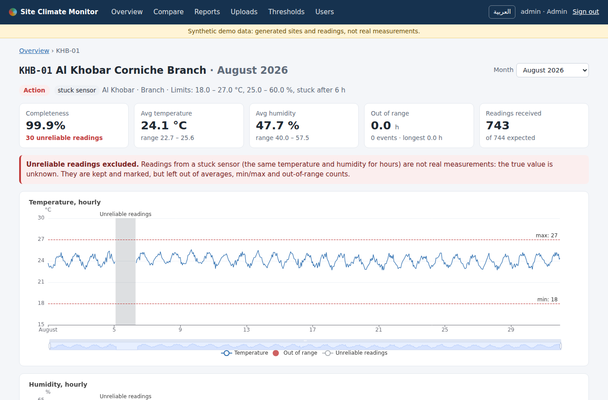

- **Hourly charts.** Dashed red lines are the limits and red dots are readings outside them. Drag the slider under a chart to zoom in.
- **Grey bands are unreliable readings.** A sensor that repeats exactly the same temperature and humidity for hours is stuck, and its true values are unknown. These readings are kept and marked, but left out of averages, min/max and out-of-range counts. A stuck sensor makes the site **Action**.
- **Below the charts:**
  - daily min/average/max
  - average by hour of day
  - the list of out-of-range events
  - the list of stuck-sensor periods
  - download links for the month's PDF report in English and Arabic

The JED-01 page for August shows a cooling failure, a 56-hour out-of-range event:

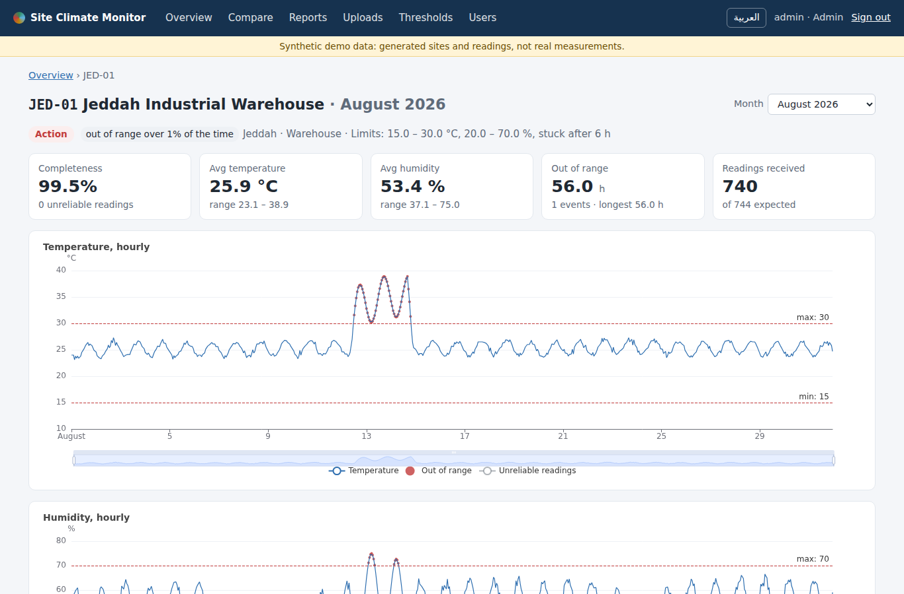

## Compare

Shows side by side for the selected sites and month:
- min/average/max temperature
- completeness and hours out of range
- average by hour of day
- monthly trend

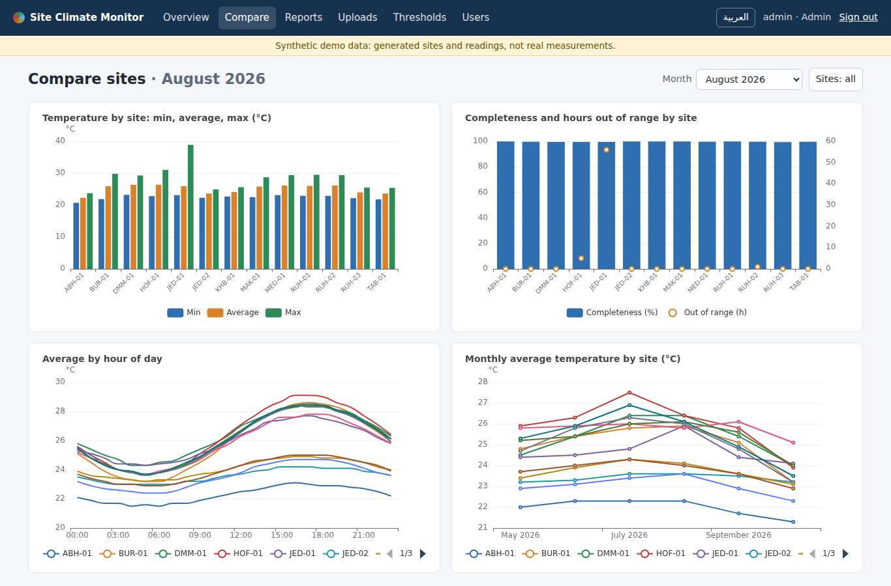

## Reports (PDF)

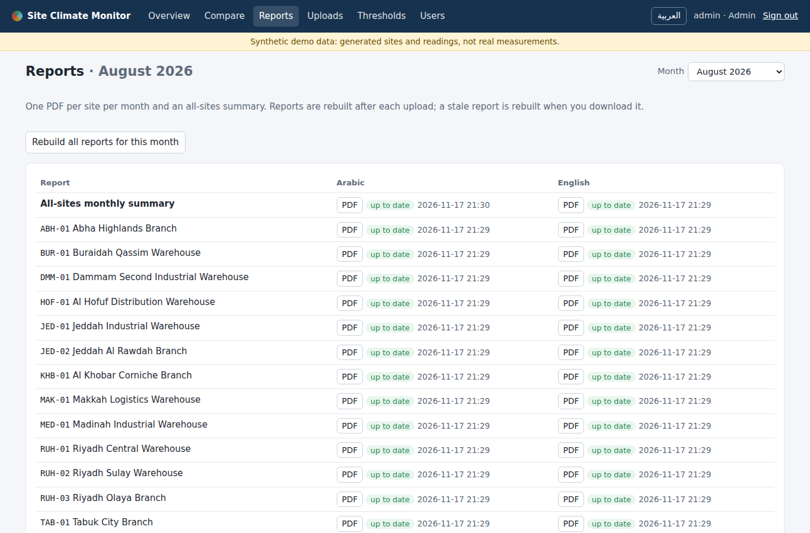

There are two kinds of PDF, each in English and Arabic:
- one report per site per month;
- one all-sites summary per month.

They show **the same numbers as the dashboard**.

- **When they are built.** Reports are rebuilt automatically after each upload. A report shows as *stale* when limits changed or newer data arrived since it was made, and downloading it rebuilds it first.
- **Admins** can rebuild a whole month with one button.

Samples: [summary EN](sample-reports/2026-08/all-sites_2026-08_en.pdf) · [summary AR](sample-reports/2026-08/all-sites_2026-08_ar.pdf) · [KHB-01 EN](sample-reports/2026-08/KHB-01_2026-08_en.pdf) · [JED-01 AR](sample-reports/2026-08/JED-01_2026-08_ar.pdf).

## Admin: uploading files

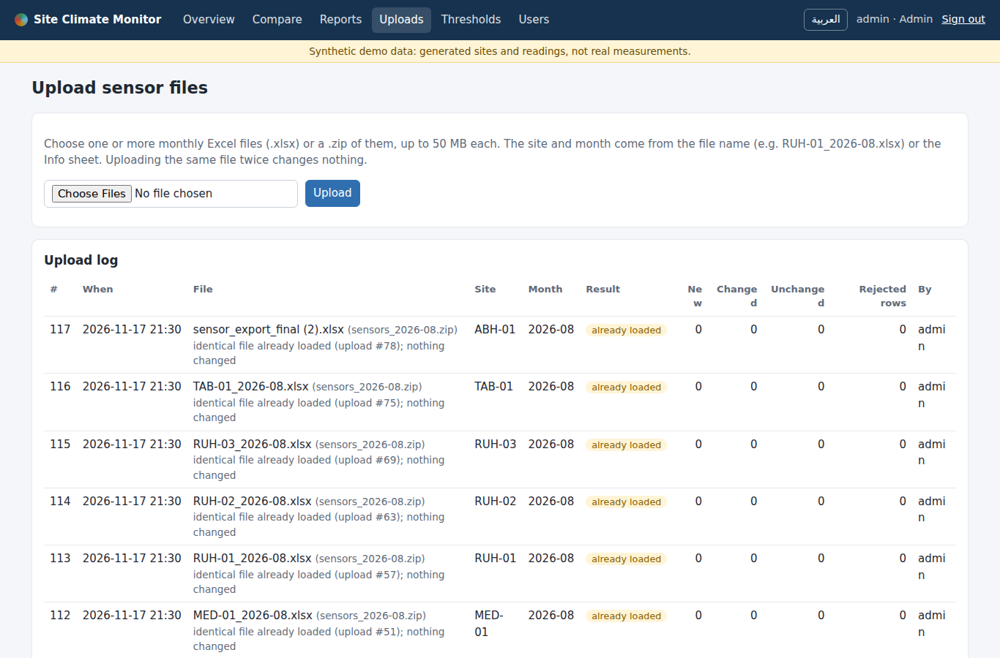

1. **Choose files.** Pick one or more monthly `.xlsx` files, or a `.zip` of them.
2. **Name each file** like `RUH-01_2026-08.xlsx` (site code, then month). Alternatively, give it an **Info** sheet with `Site code` and `Month` rows. If the file name and the Info sheet disagree, the file is rejected.
3. **Data sheet layout.** The data sheet needs the columns **Date | Time | Temperature | Humidity**. A title row above the header is fine.
4. **Read the results.** Each file is reported on its own:

| Result | Meaning |
|---|---|
| **loaded** | The rows were stored. *New / Changed / Unchanged* count hourly readings; uploading a corrected file updates only what changed. |
| **already loaded** | Exactly this file was loaded before. Nothing changes. |
| **rejected** | The whole file was refused, for example unknown site, no header, or not an Excel file. The reason is shown. |
| **failed** | An unexpected error. Nothing from that file was stored, and the other files are not affected. |

Each file is stored all-or-nothing. Re-uploading the same files is always safe:

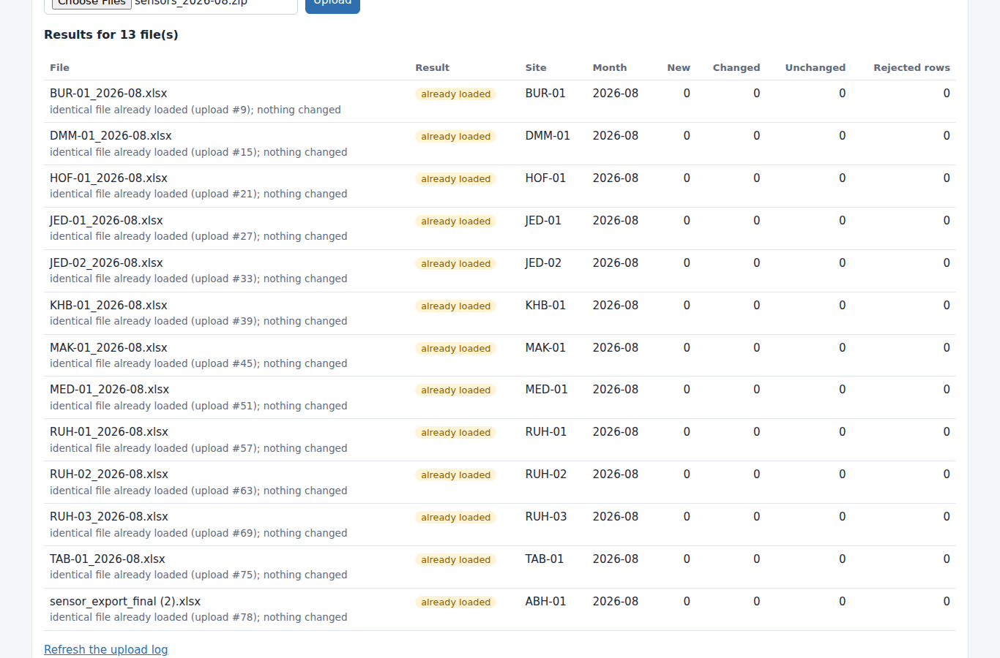

Rows that fail a check are skipped. Each skipped row is listed with its sheet row number and the reason, and the **Rejected rows** number in the upload log links to the CSV.

| Reason | Meaning |
|---|---|
| bad date / bad time | Not a real date or time, or a time that isn't on the hour |
| missing value | Temperature or humidity left blank |
| not a number | Text such as `ERR` |
| impossible temperature / humidity | Outside −40 to 70 °C, or outside 0 to 100 % |
| date outside the file's month | A row from another month |
| duplicate row | The same hour again with the same values. The first copy is kept. |
| conflicting duplicate | The same hour with different values. Both are rejected, because it can't be known which is right. |

Dates written as `DD/MM/YYYY` text, or stored as plain Excel serial numbers, are understood. A note is added to the upload log when that happens.

## Admin: limits (thresholds)

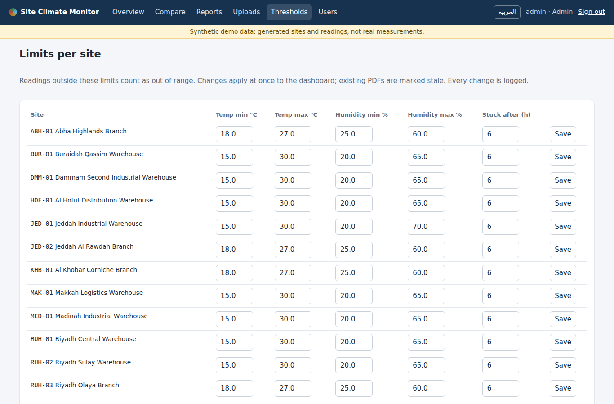

- **What each site has.**
  - a temperature range and a humidity range: readings outside them count as *out of range*;
  - "stuck after (h)": how many hours of identical readings count as a stuck sensor.
- **When changes apply.** Saving applies at once to every page. Existing PDFs are marked stale, and each PDF prints the limits it used.
- **History.** Every change is recorded with who made it and the values before and after.

## Admin: users

- **Add a user.** Give a username, a password of at least 10 characters, and a role.
- **Deactivate a user.** This signs them out at once. You cannot deactivate yourself or the last admin.
- **Set a new password.** This signs out that user's other sessions.

## Arabic

The whole interface and the PDFs are available in Arabic. The page direction switches to right-to-left. Numbers, ranges and dates stay as written ("22.7 – 25.6", "743 / 744", "2026-08-12 12:00"), so they can't be reordered by the right-to-left layout.

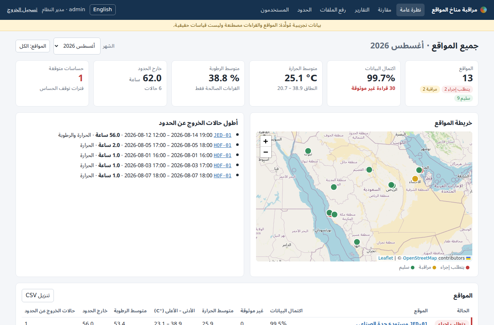

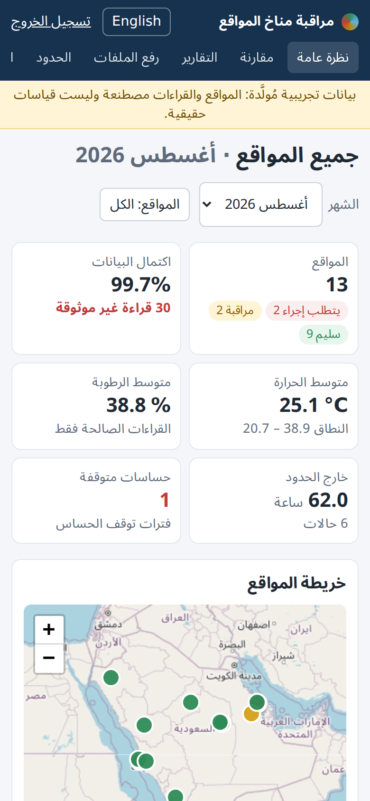 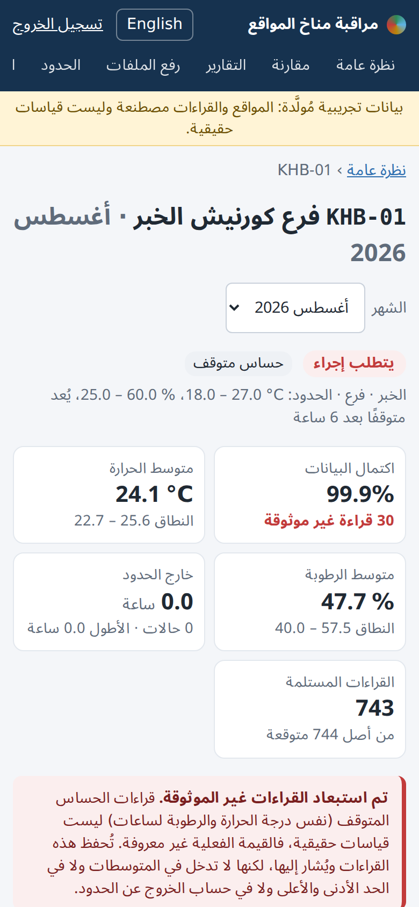
